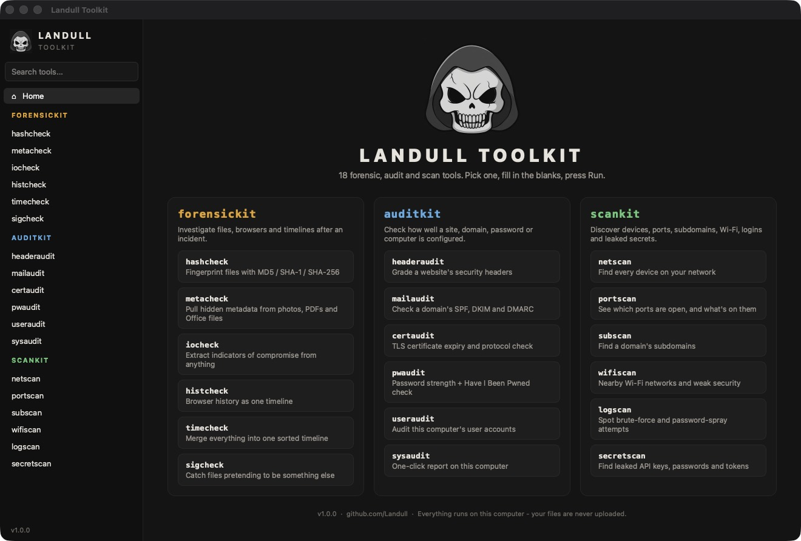
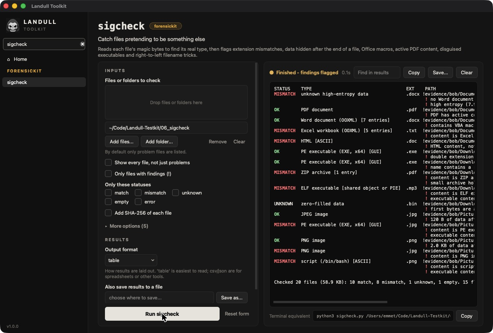

# Landull Toolkit

A desktop app for all 18 of Landull's security tools — **forensickit**, **auditkit** and **scankit** — so you don't need to use a terminal. Pick a tool from the sidebar, fill in the form (you can drag files and folders onto it), and press **Run**.

| Kit | Tools |
|---|---|
| [forensickit](https://github.com/stars/Landull/lists/forensickit) | [hashcheck](https://github.com/Landull/hashcheck) · [metacheck](https://github.com/Landull/metacheck) · [iocheck](https://github.com/Landull/iocheck) · [histcheck](https://github.com/Landull/histcheck) · [timecheck](https://github.com/Landull/timecheck) · [sigcheck](https://github.com/Landull/sigcheck) |
| [auditkit](https://github.com/stars/Landull/lists/auditkit) | [headeraudit](https://github.com/Landull/headeraudit) · [mailaudit](https://github.com/Landull/mailaudit) · [certaudit](https://github.com/Landull/certaudit) · [pwaudit](https://github.com/Landull/pwaudit) · [useraudit](https://github.com/Landull/useraudit) · [sysaudit](https://github.com/Landull/sysaudit) |
| [scankit](https://github.com/stars/Landull/lists/scankit) | [netscan](https://github.com/Landull/netscan) · [portscan](https://github.com/Landull/portscan) · [subscan](https://github.com/Landull/subscan) · [wifiscan](https://github.com/Landull/wifiscan) · [logscan](https://github.com/Landull/logscan) · [secretscan](https://github.com/Landull/secretscan) |

## Download

Get the latest version from the [**Releases**](https://github.com/Landull/LandullToolkit/releases/latest) page. Nothing else needs to be installed.

| System | File | How to open it |
|---|---|---|
| macOS (Apple Silicon) | `LandullToolkit-macOS.zip` | Unzip it and drag **Landull Toolkit** into Applications. |
| Windows 10/11 | `LandullToolkit-Windows.zip` | Unzip it and run `LandullToolkit.exe` from inside the folder. |
| Linux (x64) | `LandullToolkit-Linux.tar.gz` | Extract it and run `LandullToolkit/LandullToolkit`. |

**First launch:** the app isn't code-signed, so your system will warn you the first time you open it.

- **macOS:** open the app once. Then go to System Settings › Privacy & Security, scroll down, and click **Open Anyway** next to Landull Toolkit.
- **Windows:** when SmartScreen appears, click **More info** › **Run anyway**.

## What it does

- A form for every option of every tool. Common options are shown first, and the rest are under **More options**.
- Drag and drop files and folders onto the form, use the file pickers, or paste a path.
- Results stream into the window while the tool runs. Findings, warnings and passes are color-coded. You can stop a run, search the results, copy them, or save them.
- When a tool saves a report (CSV, JSON, HTML, KML), you get **Open** and **Show in folder** buttons.
- **Terminal equivalent**: each run also shows the matching command for the standalone script, so the app doubles as a way to learn the command-line version.
- Everything runs on your own computer. The tools that go online are pwaudit, which checks Have I Been Pwned using k-anonymity, and the network audit and scan tools, which you point at your own targets.

## Build it yourself

Building needs Python 3.9+.

- **macOS:** double-click `Build Mac App.command`. The app is built to `dist/Landull Toolkit.app`.
- **Windows:** double-click `build_windows.bat`. The app is built to `dist\LandullToolkit\LandullToolkit.exe`.
- **Linux:** run `./build_linux.sh`.
- **Run from source:** `pip install PySide6-Essentials`, then `python3 landull_toolkit.py`.

Pushing a tag such as `v1.0.1` makes GitHub Actions build all three versions, test them, and publish a release.

## Notes

- The app includes a copy of each tool from its own repo, in `tools/`.
- Some tools read protected parts of the system. For histcheck's "read this computer's browsers" option on Safari, give the app Full Disk Access in System Settings › Privacy & Security.
- Only scan or test systems you own or have permission to test.

---
Part of [Landull](https://github.com/Landull)'s toolkits.
